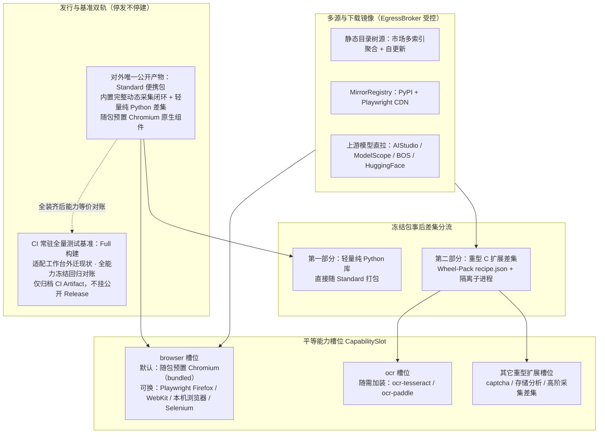

# OmniCrawler 最终统一优化方案（合并版）

> **状态**：本文件是**唯一实施依据**。合并自两份来源，冲突处以本文件为准。
> **生成时间**：2026-11-18
>
> **设计基线**：严格对齐根目录 [`优化方案.md`](优化方案.md) 锚段（§一 / §1.1 / §1.2 / §1.3）、
> [`候选优化.md`](候选优化.md) 既有取舍记录与 [`OmniCrawler/AGENTS.md`](OmniCrawler/AGENTS.md) 安全红线。
>
> **来源**：
> 1. `omnicrawler-unified-edition-components-mirrors-plan.md`（2026-11-18 19:16，五批次方案）
> 2. 本仓 2026-11-18 前序实施记录（已落地的批次 1 与批次 2 主体）
>
> **合并原则**：原文照录关键决策；已落地部分标注实测证据；未完成部分给出可执行细则。

---

## 零、当前进度总览（实测基线）

> 本节基于仓库真实状态核实，不是计划书抄写。核实时间：2026-11-18 22:00。

### 已完成（有证据）

| 项 | 证据 | 状态 |
|---|---|---|
| 三方平等能力槽位 | `core/capability_slots.py` 存在，提交 `93ec2c46` | ✅ 完成 |
| `tools/` 子目录重组 | `tools/gates/` 等已就位，提交 `e32d58ff` | ✅ 完成 |
| 轻量库并入 Standard | `pyproject.toml` 含 `python-docx` / `python-pptx` / `selectolax` | ✅ 完成 |
| recipe 多格式装配 | `component_recipe.py` 支持 `zip` / `whl` / `tar.gz` / `raw` | ✅ 完成 |
| 文档工作台迁出 | 提交 `6293e9b1`，市场 `plugins/document-workbench` 已发布 | ✅ 完成 |
| `BrowserRuntimeSpec` 统一解析 | `browser_launch.py` 含 `resolve_browser_runtime` / `launch_kwargs` | ✅ 完成（未提交） |
| 三调用点接线 | `browser_pool` / `login_session` / `action_recorder` 均消费 spec | ✅ 完成（未提交） |
| 组件市场三分支 | `catalog.json` 含 `components`，`component_market_logic.py` 就绪 | ✅ 完成 |
| 市场/模板/组件搜索对齐 | 三支均有过滤，提交 `cf578ec9` | ✅ 完成 |

**实测验证**（引擎切换隔离，本方案核心验收点）：

```
browser-firefox:           engine=firefox,  channel=None,                chromium专属参数=False
browser-webkit:            engine=webkit,   channel=None,                chromium专属参数=False
browser-chromium-bundled:  engine=chromium, channel='chrome-for-testing', chromium专属参数=True
```

### 未完成（本方案要做的）

| 批次 | 内容 | 状态 |
|---|---|---|
| **0** | **收尾上一轮遗留（L1-L6，见下）** | **待做，建议最先** |
| 1 | 标准库完整性补齐（`.spec` 收集） | 待查 |
| 2 | 浏览器槽位登记 + 画布内核切换 + 登录态 `engine_family` | 部分 |
| 3 | `omnicrawler-worker --component-runner` Wheel-Pack 运行器 | 未开始 |
| 4 | 市场三栏多源聚合 + 「源与下载镜像设置」 | 未开始 |
| 5 | `Full` 基准适配 + 「停发不停建」 | 未开始 |

### 已知既有失败（非本轮引入）

- `tests/unit/fetching/test_session_mutation.py::test_reset_evicts_cached_jar_and_prevents_old_reference_from_restoring_file`
  —— 已用 `git checkout` 回退到 HEAD 复验，**HEAD 版本同样失败**。

### 上一轮会话（2026-11-18 夜间）遗留的未完成项

> 本节记录**另一次会话**（`document-workbench` 迁移 + 市场三分支）结束时
> 明确挂起、但未做完的事项。它们不在五批次原文里，是本次合并新补的。
> 每项都有实测证据，不是推测。

| # | 遗留项 | 实测证据 | 为什么重要 |
|---|---|---|---|
| L1 | **示例 recipe 的 sha256 是占位值** | `components/tesseract-chi-sim/recipe.json` 里 `sha256` 全为 `0`；`set(d) == {"0"}` 为 `True` | 按现在状态安装必然"哈希不符"而失败。**发布前必须换成真实哈希**，或明确标注为模板示例 |
| L2 | **组件没有创作者签名** | `components/` 下 `creator.sig` 数量 **0**；对比 `templates/` 15 个、`plugins/document-workbench` 1 个 | 三分支里只有组件缺签名，与"三支同等成熟度"目标不符。`sign_plugin.py` 已支持 `recipe.json` 载体，只差实际执行 |
| L3 | **组件只读单源，未接入 `aggregate_catalogs`** | `component_manager.py` 用的是 `fetch_catalog_verified`（单源）；`aggregate_catalogs` 仅 `plugin_market_workers.py` 在用 | 方案 §5.1 要求三栏共享多市场源；实际**插件用了聚合、模板与组件都没用**（原文写"插件/模板已接入"与事实不符） |
| L4 | **模板页同样未接多源聚合** | `template_market.py` 只有 `fetch_catalog_verified`，无 `aggregate_catalogs` | 与 L3 同源问题，需一并处理 |
| L5 | **浏览器改动未提交** | 工作区 5 个文件为 `M` 状态、`tests/unit/browser/` 未跟踪 | 引擎侧与三调用点已可用（lint 已清、切换隔离已验证），但还没进版本库 |
| L6 | **`tests/unit/browser/` 新测试未纳入版本库** | `git status` 显示 `??` | 未跟踪文件不参与 CI，等于没有护栏 |

**L1 的处理建议**（两条路，需维护者选）：

- **路线 A**：真正下载 `chi_sim.traineddata` 算出真实 sha256 填入。代价是一次约 2.4 MB 下载；
- **路线 B**：把 `tesseract-chi-sim` 明确标注为 `recipe 格式示例（不可直接安装）`，
  并在 catalog 条目标记 `example: true`，避免用户误装。

> 建议 A。因为一个"示例"如果装不上，它对用户的价值仅剩格式参考；
> 而真实可用的语言包组件才是"组件市场"这个分支存在的理由。

---

## 一、核心架构定案



### 四条硬边界（不可破坏）

1. **开箱即用不退化**：`Standard` 继续随包内置单份完整 Chromium，解压即具备完整动态渲染与登录态采集，**无需首次联网装浏览器**。
2. **安全防线零削弱**：保留 `RUNTIME-MANIFEST.json` 未知文件拒绝、`EgressBroker` 默认阻断（fail-closed）、`component_trust.pub.pem` 冷钥签名、`asset_trust.py` 模型信任声明；**绝不在 `recipe.json` 中引入可执行安装脚本**。
3. **`Full` 永不删除**：改造维护使其贴合最新代码，作为 CI 全量冻结兼容性与「Standard 全装齐等价性」的权威基准。
4. **镜像诚实透明**：官方源恒为首选（避免吊销墓碑与安全补丁延迟），仅在官方源**网络不可达或超时**时提醒切换；**绝不引入未白名单路径拼接代理**（如公共 `ghproxy`）。

### 维护者已拍板的裁决（继承，不再重复讨论）

| 裁决 | 内容 |
|---|---|
| 组件地位 | **市场里插件和组件是同地位的**，不把组件放到核心地位 |
| 微内核 | 「微内核宿主 + 进程级隔离组件」+ Trace Viewer 重做造任务入口：**暂不做** |
| 浏览器 | **不能剥离**，但要做成可替换的原生组件（可换 Firefox/WebKit） |
| Full | **不能删**，改造为全量测试基准 |
| 差集分流 | 几百 KB 轻量库允许打包；`paddle` 等大依赖**不内置**，但要能装回来 |
| 镜像站 | 现阶段**内置大厂+高校镜像 + 支持用户填写**，维护者不同步维护 |

---

## 二、批次 1：轻量库与 recipe 格式（已基本完成，需补验收）

### 2.1 已完成部分

**轻量库并入 Standard**（`pyproject.toml` 实测）：

```toml
"openpyxl>=3.1,<4",
"python-docx>=1.1,<2",
"python-pptx>=1.0,<2",
"beautifulsoup4>=4.12,<5", "lxml>=5,<7", "cssselect>=1.2,<2",
"selectolax>=0.4.2,<2", "pypdfium2>=5,<6", "pdfplumber>=0.11,<1",
"pypdf>=4,<7", "reportlab>=4,<6", "chardet>=5,<8",
```

**recipe 格式扩展**（`component_recipe.py:61` 实测）：

```python
SUPPORTED_ARTIFACT_FORMATS = frozenset({"zip", "whl", "tar.gz", "raw"})
```

`raw` 必须**显式声明**才启用（防误判），归档可按 URL 后缀确定性推断。

### 2.2 待补：标准库完整性收集

**目的**：冻结包里外部 Wheel-Pack 组件导入冷门标准库（`unittest` / `xmlrpc` / `sysconfig`）时不报 `ModuleNotFoundError`。

**落点**：`packaging/OmniCrawler-Standard.spec`（及 Linux/macOS 对应 spec）。

**验收**：
- 构建后产物内 `lib/python3.12/` 含 `unittest`、`xmlrpc`、`sysconfig`、`concurrent`、`multiprocessing`；
- 反例：裁剪掉其中任一模块后，Wheel-Pack 组件启动必须报明确缺模块错，而不是静默失败。

---

## 三、批次 2：浏览器可替换原生组件

### 3.1 已完成的引擎侧（本仓实测）

`browser_launch.py` 提供：

| 符号 | 作用 |
|---|---|
| `BrowserRuntimeSpec` | 统一启动契约（`engine_family` / `driver_kind` / `channel` / `executable_path` / `args` / `verify_tls`） |
| `resolve_browser_runtime(config, *, slot_registry, preferred_id, headless, custom_args)` | 集中解析，消除散落硬编码 |
| `launch_kwargs(spec, *, headless)` | 产出 Playwright `launch()` 参数 |
| `launch_channel()` | 兼容旧调用点的 channel 单一来源 |
| `build_launch_args()` | 参数生成（含 TLS 拒绝关闭、无头保真参数） |

**内核专属参数隔离已验证**：切到 `firefox` / `webkit` 时 `channel=None` 且
`--disable-renderer-backgrounding` 等 Chromium 专属参数**完全不注入**。

**三调用点已接线**：

```python
# browser_pool.py:125（实测）
browser_engine = getattr(playwright, runtime_spec.engine_family, playwright.chromium)
browser = browser_engine.launch(**launch_kwargs(runtime_spec))

# login_session.py / action_recorder.py 同构
```

### 3.2 剩余待做

#### (a) `browser-chromium-bundled` 槽位登记

- 把 `Standard` 包内 `browsers/chromium-*` 注册为 `browser-chromium-bundled`，
  状态标识 `随包预置 · 已就绪`；
- 与市场安装组件（`browser-firefox` / `browser-webkit` / `selenium-geckodriver`）
  及「本机浏览器路径」在**同一 `browser` 槽位平等管理**；
- 随包 `browsers/` 继续受 `RUNTIME-MANIFEST.json` 完整性保护；
  用户新装内核落盘 `<portable_data_root>/.omnicrawler/components/browser-<engine>/`，
  不触碰宿主只读清单。

#### (b) 登录态 `engine_family` 元数据绑定

按 `优化方案.md` §11.1 登录态同源原则：
- 用户切到 Firefox 后，「登录态管理」弹窗**直接拉起同一个 Firefox 内核**完成登录；
- 已有会话元数据记录所属 `engine_family`；
- 跨内核复用时**界面显式提示**，不静默混用。

#### (c) 任务画布内核切换

在抓取策略区联动展示当前内核（`Chromium（随包预置）` / `Firefox（组件）` / `本机浏览器`），
无需绕去设置页即可按任务或全局切换。

### 3.3 验收与反向断言

- `firefox` / `webkit` 模式下**绝不出现** `--disable-renderer-backgrounding`
  与 `chrome-for-testing` channel；
- `chromium` 默认模式的无头保真参数与 TLS 策略**字节级一致**（与改动前对比）；
- 反向断言：把上述隔离条件去掉 ⇒ 测试必红 ⇒ 字节级还原。

---

## 四、批次 3：Wheel-Pack 重型差集子进程运行器

### 4.1 社区三类方案定案

| 维度 | 方案 A（进程内挂 Wheel） | 方案 B（自带解释器） | **方案 C（定案）** |
|---|---|---|---|
| 做法 | 主进程 `sys.path` + `add_dll_directory` | 组件包内自带 `python-embed` | **PEP 427 ZIP Wheel-Pack + 复用 `omnicrawler-worker` 子进程** |
| DLL 冲突 | **高风险**（`libiomp5md`/`msvcp140`/OpenSSL） | 低 | **低**（子进程内隔离） |
| 标准库缺失 | **高风险** | 无 | **由批次 1 补齐解决** |
| 任意代码执行 | 需 `pip`（`setup.py` 风险） | 需维护三平台发行包 | **零 pip、零脚本**（`.whl` 是纯数据 ZIP） |

**选 C 的决定性理由**：PEP 427 规范下 `.whl` 就是纯数据 ZIP，
可直接复用 `component_recipe.py` 逐件校验 64 位 SHA-256 + `cp312` ABI + 平台架构后解压，
**完美契合既有安全模型**。

### 4.2 落地要点

1. **平时零冗余**：`Standard` 绝不内置 `paddlepaddle` / `paddleocr` / `paddlex` /
   `opencv-python-headless` / `ddddocr` / `onnxruntime` / `duckdb` / `pyarrow` / `scrapy`。
2. **极轻量组件包**：`ocr-paddle` 只含签名清单 + 几 KB 的 `recipe.json`，
   列出 `python_abi: "cp312"` 锁定的 wheel 闭包（每个 `.whl` 带固定 URL + 精确 sha256）。
3. **下载经 `EgressBroker` + `MirrorRegistry`**：默认官方 `files.pythonhosted.org`，
   启用镜像时路由至清华 TUNA / 阿里云 / 中科大等；**无论官方还是镜像，强制同一份 sha256 校验**。
4. **模型仍走上游直拉**：`PPStructureV3` 等大权重**绝不放进组件或 Wheel-Pack**，
   继续用 `model_download.py` 四源拉取，遵循 `asset_trust.py` 的信任披露。
   > ★ **铁律**：`paddle_models` **严禁进入 `recipe.json`**（`候选优化.md` 条目 9、
   > `asset_trust.py:68-72` 已用代码与反向守卫钉死）。绝不伪造哈希。
5. **子进程引导**（`omnicrawler-worker --component-runner`）：
   - 启动前**二次核验** `component_trust.pub.pem` Ed25519 签名 + 已落盘文件哈希（防落地后篡改）；
   - 子进程早期配置原生库路径：Windows `os.add_dll_directory`；
     Linux/macOS 注入 `LD_LIBRARY_PATH` / `DYLD_LIBRARY_PATH` / `FLAGS_mklml_dir`；
   - 仅在**该子进程内**把 `site-packages` 挂入 `sys.path`，按 `ocr-file-v1` 协议返回结果。
6. **兼容原生可执行文件组件**：`ocr-tesseract` 这类 C++ 二进制 + `.traineddata`
   继续走原生子进程，**两套模式在同一组件协议下并存**。

### 4.3 验收

构造"篡改组件目录内 `.whl` 摘要"的场景，断言**子进程启动前立即阻断**。

---

## 五、批次 4：市场三栏多源聚合 + 源与镜像设置

### 5.1 三栏统一治理

1. **补齐组件栏多源聚合**：`component_market_logic.py` 当前只读单源，
   需接入 `aggregate_catalogs`，与 `plugin_market_catalog.py` 同构，
   共享多市场源配置、来源角标、信任公钥校验、离线本地目录源能力。
   > ⚠️ **实测更正**：原文写「插件与模板已接入 `aggregate_catalogs`」，
   > 核实后**只有插件侧用了**（`plugin_market_workers.py`）；
   > `template_market.py` 与组件栏一样只有 `fetch_catalog_verified`（单源）。
   > 因此本项范围应扩为**模板 + 组件两栏**（见 §零 L3 / L4）。
2. **索引新鲜度显式展示**：市场页顶部展示各源签名的 `generated_at`
   （如 `官方主源 · 索引生成于 YYYY-MM-DD HH:MM`），镜像滞后超阈值时温和标黄。
3. **`component_recipe.py` 单文件与归档能力已就绪**（批次 1 已完成），
   复用 `core.archive_security` 的路径穿越拦截、大小上限、SHA-256 先验后写。

### 5.2 「源与下载镜像设置」

将 `market_sources_dialog.py` 升级为统一面板，四类通道：

| 通道 | 对象 | 内置预设 + 自定义 | 安全机制 |
|---|---|---|---|
| ① 市场索引与自更新源 | `catalog.json`、`latest.json` | 官方 GitHub Pages/Releases + 用户自建 HTTPS 镜像或局域网目录（**不内置公共 `ghproxy`**） | Ed25519 验签 + `sequence` 防重放 + `tombstones` 拦截 |
| ② Python 轮子镜像 | Wheel-Pack `.whl` 闭包 | 官方 PyPI + **清华 TUNA / 阿里云 / 腾讯云 / 中科大 / 华为云** | `MirrorRegistry` + `mirror_presets.py`，启用时写入 `EgressBroker` 白名单，强制 sha256 |
| ③ 浏览器内核 CDN | Firefox/WebKit/Chromium 包及驱动 | 官方 `playwright.azureedge.net` / `cdn.playwright.dev` + **淘宝 npmmirror / 华为云** | `EgressBroker` 白名单 + recipe 固定 sha256 |
| ④ OCR/AI 模型上游 | PaddleOCR 大模型权重 | **AIStudio / ModelScope / BOS / HuggingFace** + 本地已下载目录 | 展示 `asset_trust.py` 信任说明（不伪造哈希） |

### 5.3 官方站 vs 镜像站差异明示

**常驻可展开说明卡**（置于设置顶部与首次切换确认框）：

- **防篡改能力完全相同**：均有冷钥签名或固定 SHA-256，镜像返回篡改字节会被本地校验拒绝，
  **不降低防投毒安全性**；
- **同步时效与吊销延迟不同**：镜像有同步周期，可能拉不到刚发布版本或晚收到下架墓碑
  ⇒ **官方源连通正常时默认优先官方**；
- **网络元数据可见性不同**：连镜像站时请求方 IP 与下载时间对镜像运营方可见。

**切换提醒触发条件（克制、精准）**：
- **仅**官方源网络连接失败 / DNS 失败 / TLS 超时 / 持续低速时，弹非模态提示条；
- **严禁触发**：签名校验失败、SHA-256 不匹配、`sequence` 回退、ABI/平台不兼容
  ⇒ 一律阻断报错，**绝不诱导用户换镜像绕过校验**。

### 5.4 验收

- 启用镜像时 `EgressBroker` 白名单同步放行；未启用时默认 fail-closed 拦截；
- **签名/哈希错误绝不触发切换镜像弹窗**（反向断言）。

---

## 六、批次 5：Full 基准适配 + 停发不停建

### 6.1 为什么绝不删除 Full

`Full` 是全依赖冻结兼容性**试金石**：PyInstaller 下最容易出问题的恰是
`paddle` / `cv2` / `lxml` / `PySide6` / `playwright` / `selenium` / `scipy`
同处冻结环境时的 hooks、动态库收集与命名空间包冲突。
删掉它，后续升级 Python 或基础库就**失去第一时间发现冻结回归的自动基准**。

### 6.2 适配内容

1. **清理陈旧残留、对齐最新源码树**：
   `OmniCrawler.spec`（及 Linux/macOS Full spec）、`build_*.ps1/sh`、
   `packaging/artifact-budgets.json`——剔除已外迁模块的失效 hiddenimports/datas，
   补齐 `capability_slots` / `browser_launch` 多内核解析 / 完整标准库收集。
2. **升级为等价性对账基准**：
   `tools/packaging/portable_smoke_test.py` 新增
   **「Standard 全装齐等价性对账」**——验证
   `Standard + 全套可选组件 + document-workbench` 暴露的 `CapabilitySlot` 可用集合
   与 `Full` 基准完全对齐。
3. **CI 与发布流「停发不停建」**：
   - CI 每次**照常编译并跑通** `Full` 便携冒烟，产物传 Actions Artifacts；
   - 面向用户的 Release 与 `latest.json` **仅发布单一 Standard 包**。

### 6.3 硬性前置条件（切换公开 Release 前必须逐条核验）

1. 维护者用离线冷私钥生成并落位正式 `component_trust.pub.pem`，
   为官方市场组件与 `document-workbench` 完成正式签名；
   > **实测**：`configs/component_trust.pub.pem` 已存在；`document-workbench` 已于
   > 提交 `deaafb9` 完成维护者发布（catalog 收录，插槽数 9→10）。
2. CI 中 `Full` 与 `Standard` 双轨冒烟全绿，且等价性对账通过；
3. 干净环境完成端到端验收：`Standard` 开箱动态采集 → 切换镜像安装 `ocr-paddle` +
   上游拉取模型 → 安装 `document-workbench` → 切换 Firefox 内核。

---

## 七、实施顺序与门禁

### 顺序

```
批次 0（收尾上一轮遗留 L5/L6 + L1/L2）      ← 新增，最先做
   → 批次 1（补标准库） → 批次 2（浏览器槽位+画布） → 批次 3（Wheel-Pack 运行器）
   → 批次 4（多源聚合+镜像设置，含 L3/L4） → 批次 5（Full 适配+停发不停建）
```

每批次**独立可回退**，做完一批提交一次，全绿再进下一批。

### 批次 0：收尾上一轮遗留（新增，建议最先做）

理由：这些是**已经写好但没落地**的东西，放着会腐化；且 L5/L6 不提交，
后续任何人在这个工作区上继续干活都可能覆盖掉它。

| 步骤 | 动作 | 验收 |
|---|---|---|
| 0.1 | 跑完整门禁确认浏览器改动无连带破坏 | `static` + `mypy` + `ruff` 全绿；`tests/unit/browser` 与 `tests/unit/fetching` 全过（既有失败除外） |
| 0.2 | 提交浏览器改动（L5）+ 纳入 `tests/unit/browser/`（L6） | `git status` 干净；新增测试参与 CI |
| 0.3 | 处理 L1：示例 recipe 的真实 sha256 | 装 `tesseract-chi-sim` 能成功；或标注为不可安装的示例 |
| 0.4 | 处理 L2：给组件 `recipe.json` 加创作者签名 | `components/` 下有 `creator.sig` + `creator.identity`；`validate_submission` 能验过 |

### 每批必过的门禁

| 门禁 | 命令 |
|---|---|
| 静态自证 | `python tools/self_verify.py --set static` |
| 类型 | `python -m mypy src/omnicrawler` |
| 风格 | `ruff check src tests tools` |
| 定向回归 | 与该批次相关的 `tests/unit/**` |

### 判据纪律（来自 AGENTS.md，必须遵守）

- **反向断言**：新守卫必须"装回缺口 ⇒ 必红 ⇒ 字节级还原"，只绿不红等于没装护栏；
- **空集合判红**：选中 0 个用例必须红；
- **行尾按字节实测**：以 `.gitattributes` 为唯一准据；
- **禁用工作量表述**：用「用户影响 / 证据强度 / 改动风险 / 维护成本」。

### git 红线

- 绝不用 `git rm`；绝不用 `git stash`；不在 worktree 里跑会触发 `git gc` 的操作；
- 远端真值只用 `gh api` 核实。

---

## 八、待确认的细节

1. **轻量库名单**：`openpyxl` / `reportlab` / `selectolax` / `python-docx` / `python-pptx`
   已并入 Standard（**已实施**）；`paddle*` / `opencv*` / `ddddocr` / `onnxruntime` /
   `duckdb` / `pyarrow` / `scrapy` 全部走事后 Wheel-Pack。
2. **浏览器组件首批范围**：随包 Chromium + 「指定本机浏览器路径」外，
   首批建议提供 **Playwright Firefox** 与 **Selenium GeckoDriver/ChromeDriver**；
   WebKit 在 Windows 上游兼容性弱，作为次优可选。

---

## 附：本文件与原方案的关系

| 原方案章节 | 本文件处理 |
|---|---|
| 一、架构定案 | 照录，补实测验证数据 |
| 二、浏览器专题 | 照录，**标注引擎侧已完成 + 三调用点已接线**（原方案写"待做"） |
| 三、paddle 差集 | 照录，强化 `paddle_models` 禁止入 recipe 的铁律 |
| 四、Full 基准 | 照录，补 `component_trust.pub.pem` 与工作台已就绪的实测状态 |
| 五、多源镜像 | 照录，**更正「插件/模板已接入聚合」的表述**（实测只有插件接入了） |
| 六、五批次路线 | 照录，并把批次 1 标为"已基本完成"、批次 2 标为"引擎侧完成" |
| 七、待确认 | 照录 |
| **（新增）§零 遗留项 L1-L6** | **本文件新增**：上一轮会话结束时挂起但未做完的事项，含实测证据与处理建议 |
| **（新增）批次 0** | **本文件新增**：收尾 L1-L6 的前置批次 |

**未合并的内容**：原方案里的 file:// URI 链接（指向本机绝对路径）已改为仓库内相对路径；
mermaid 图保持原样。

**本文件的独有增量**（原方案里没有的）：

1. §零「遗留项 L1-L6」——把上一次会话的未完成事项**具象成可验收条目**，每条附实测证据；
2. 批次 0——把"收尾"排到最前，理由是半成品放着会腐化；
3. §5.1 的实测更正——纠正原方案对模板栏状态的误述；
4. §零「已完成」表里的实测输出（引擎切换隔离的三行结果）。
